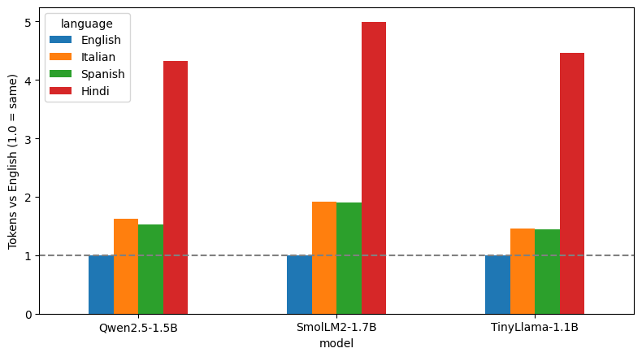
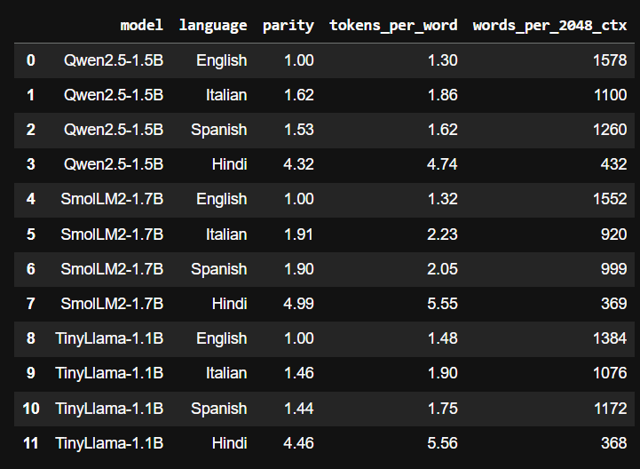

# European SLM Tokenisation

**Does the same sentence cost more for a small language model to read in Italian or Spanish than in English? And how does that compare with Hindi?**

I ran the same 300 sentences through the tokenizers of three small language models and counted the tokens.

## TL;DR

- **Italian and Spanish cost about 1.4x to 1.9x the tokens of English**, depending on the tokenizer. The two languages are almost identical to each other for every model.
- **Hindi costs about 4.3x to 5.0x the tokens of English**, far more than either European language.
- In a fixed context window, that means only **half to two-thirds** of the English content fits for Italian and Spanish, and about **one fifth** for Hindi.



## Why look at this?

Small models run with a fixed context window and a limited compute budget, often on devices with little memory. Every extra token a sentence needs uses up part of that window and adds work for the model. If a language needs twice as many tokens as English for the same meaning, a small model can read only half as much of it. That makes tokenisation cost a practical question, not just a technical detail.

## Same meaning, different length

One of the 300 sentences, in the three languages:

| Language | Sentence |
|---|---|
| English | "We now have 4-month-old mice that are non-diabetic that used to be diabetic," he added. |
| Italian | "Abbiamo topi di quattro mesi che prima erano diabetici e ora non lo sono più", ha aggiunto. |
| Spanish | «Actualmente, tenemos ratones de cuatro meses de edad que antes solían ser diabéticos y que ya no lo son», agregó. |

The notebook measures this over all 300 sentences for every language and model.

## How it was measured

| Item | Choice |
|---|---|
| Data | FLORES+ (`openlanguagedata/flores_plus`), `devtest` split, first 300 sentences per language, same sentences in every language |
| Languages | English (baseline), Italian, Spanish, Hindi (contrast) |
| Tokenizers | Qwen2.5-1.5B, SmolLM2-1.7B, TinyLlama-1.1B-Chat-v1.0 |
| Context window for estimates | 2048 tokens |
| Special tokens | Not counted |

Only tokenizers are loaded, not model weights, so the whole notebook runs on a free Colab CPU in a few minutes.

**Metrics**

- **Token parity vs English**: total tokens for a language divided by total tokens for the same 300 sentences in English. 1.00 means the same cost as English. This is the main metric.
- **Tokens per word**: total tokens divided by whitespace-separated words. This is not directly comparable across languages, because a word in one language is not the same amount of content as a word in another.
- **Share of English content that fits**: `1 / parity`. A language that needs 2x the tokens fits half as much content in the same window.

## Results

### Token parity vs English (lower is better, 1.00 = English)

| Model | English | Italian | Spanish | Hindi |
|---|---|---|---|---|
| Qwen2.5-1.5B | 1.00 | 1.62 | 1.53 | 4.32 |
| SmolLM2-1.7B | 1.00 | 1.91 | 1.90 | 4.99 |
| TinyLlama-1.1B | 1.00 | 1.46 | 1.44 | 4.46 |

### Share of English content that fits in the same context window

| Model | Italian | Spanish | Hindi |
|---|---|---|---|
| Qwen2.5-1.5B | ~62% | ~65% | ~23% |
| SmolLM2-1.7B | ~52% | ~53% | ~20% |
| TinyLlama-1.1B | ~68% | ~69% | ~22% |

### Tokens per word

| Model | English | Italian | Spanish | Hindi |
|---|---|---|---|---|
| Qwen2.5-1.5B | 1.30 | 1.86 | 1.62 | 4.74 |
| SmolLM2-1.7B | 1.32 | 2.23 | 2.05 | 5.55 |
| TinyLlama-1.1B | 1.48 | 1.90 | 1.75 | 5.56 |

Screenshot of the full results table from the notebook:



## What stands out

- **SmolLM2-1.7B is the most expensive for Italian and Spanish** (about 1.9x). TinyLlama-1.1B looks cheapest (about 1.45x), but parity is relative to each model's own English, and TinyLlama's English tokens per word (1.48) is the highest of the three. In absolute tokens per word, **Qwen2.5-1.5B is lowest** for both Italian (1.86) and Spanish (1.62).
- **Italian and Spanish behave almost the same** in all three tokenizers, while Hindi is in a different range altogether.
- The Hindi numbers are close to my earlier study, which reported 4.40x, 5.09x and 4.55x for the same three models on FLORES-200. This run gives 4.32x, 4.99x and 4.46x. This run uses FLORES+ and total-token parity, which may explain the small difference; I have not isolated the cause.

These are measurements on 300 sentences with three tokenizers. They show how much more tokens each language needs, not why.

## Where this fits

Tokenizer fertility across European languages and the effect of quantization on different languages have been studied before. This project is a small replication and extension in that direction, not a claim of a new research gap.

- Salamandra Technical Report ([arXiv:2502.08489](https://arxiv.org/abs/2502.08489)): includes a tokenizer fertility study across several European languages, including Romance languages such as Spanish and Italian.
- EuroLLM: Multilingual Language Models for Europe ([arXiv:2409.16235](https://arxiv.org/abs/2409.16235)): compares the fertility of its tokenizer with the Mistral, LLaMa-3 and Gemma tokenizers.
- Optimizing LLMs for Italian: Reducing Token Fertility and Enhancing Efficiency Through Vocabulary Adaptation ([arXiv:2504.17025](https://arxiv.org/abs/2504.17025)): addresses token fertility for Italian.
- Beyond Fertility: Analyzing STRR as a Metric for Multilingual Tokenization Evaluation ([arXiv:2510.09947](https://arxiv.org/abs/2510.09947)): evaluates tokenization across languages including English, German, French, Spanish, Italian and Hindi.
- How Does Quantization Affect Multilingual LLMs? (Marchisio et al., Findings of EMNLP 2024, [arXiv:2407.03211](https://arxiv.org/abs/2407.03211)): finds that quantization affects languages differently, with non-Latin-script languages harmed more on average.

This work builds on my earlier study of Hindi, Korean and English (`multilingual_slm_tokenisation.ipynb`, on my GitHub profile: https://github.com/shruti18sk).

## Limitations

- Tokenisation only. Memory use, latency and quantization are not measured.
- 300 sentences, 3 tokenizers, 3 languages besides English.
- Words are counted by whitespace splitting, a rough proxy, especially across languages.
- The 2048-token estimates ignore prompts and special tokens.
- FLORES+ is translated text, so results may differ on natural text in each language.

## Run it yourself

1. Create a Hugging Face account and a read access token.
2. Accept the terms for the gated dataset at https://huggingface.co/datasets/openlanguagedata/flores_plus.
3. Open `european_slm_tokenisation_v2.ipynb` in Google Colab (File, then Upload notebook).
4. Run the cells in order. Cell 2 opens a login box where you paste your token. Do not save the token in the notebook.

To run locally:

```bash
git clone https://github.com/shruti18sk/European_SLM_Tokenisation.git
cd European_SLM_Tokenisation
pip install -r requirements.txt
jupyter notebook
```

## Repository structure

```
European_SLM_Tokenisation/
├── european_slm_tokenisation_v2.ipynb   # the experiment
├── parity_chart.png                     # chart shown above
├── results.png                          # screenshot of the results table
├── requirements.txt
└── README.md
```

## Next steps

- Measure how 4-bit quantization affects Italian and Spanish compared with English in the same small models.
- Add more European languages and more tokenizers.

## Author

Shruti Singh Kushwah · [github.com/shruti18sk](https://github.com/shruti18sk)
